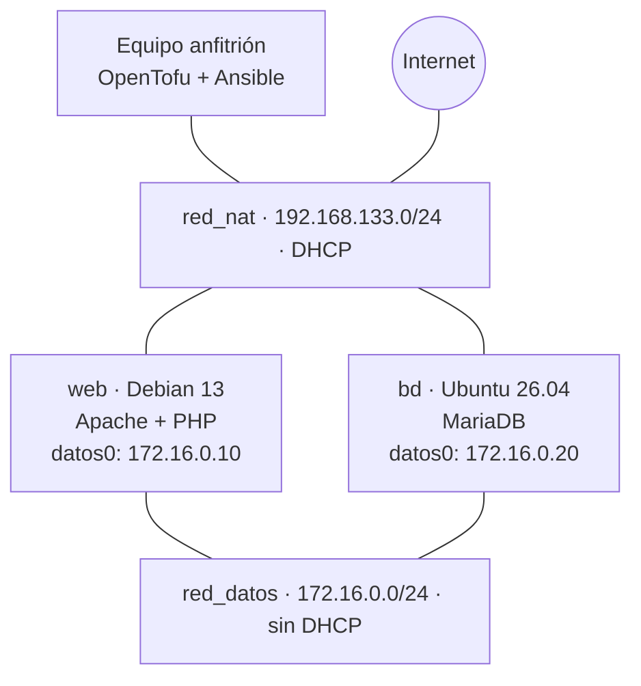

# Proyecto 1: Infraestructura como código

Escenario desplegado con **OpenTofu** (libvirt/KVM) y configurado con **Ansible**: una aplicación web de libro de visitas en PHP ([guestbook_php](https://github.com/josedom24/guestbook_php)) con base de datos MariaDB, repartida en dos máquinas y dos redes.

Todo el escenario se levanta desde cero con dos comandos.

## Esquema del escenario



| Máquina | Sistema | Servicio | nat0 (red_nat) | datos0 (red_datos) |
|---------|---------|----------|----------------|--------------------|
| web | Debian 13 | Apache + PHP | DHCP | 172.16.0.10 |
| bd | Ubuntu 26.04 | MariaDB | DHCP | 172.16.0.20 |

- `red_nat`: red NAT con DHCP. Da salida a Internet y permite que el anfitrión llegue por SSH.
- `red_datos`: red aislada, sin DHCP, con IP estáticas. Por aquí viaja el tráfico entre la web y la base de datos.
- Las máquinas son clones ligeros de una imagen base. cloud-init crea el usuario, instala la clave SSH y configura las dos interfaces por su MAC.

## Estructura del repositorio

```
.
├── README.md
├── .gitignore
├── opentofu/              Escenario: redes, volúmenes, máquinas, cloud-init, inventario y outputs
└── ansible/
    ├── ansible.cfg
    ├── site.yaml          Playbook principal
    ├── group_vars/        Variables (all.yaml y servidores_web.yaml)
    └── roles/
        ├── commons/       Actualización y paquetes comunes
        ├── bd/            MariaDB, base de datos, usuario y tablas
        └── web/           Apache, PHP, virtual host y aplicación
```

El inventario `ansible/inventario.ini` lo genera OpenTofu en cada `apply` (grupos `servidores_web` y `servidores_bd`). No se sube al repositorio.

## Requisitos

- Linux con libvirt y QEMU/KVM, y permisos para usar `qemu:///system`.
- OpenTofu y Ansible instalados.
- Colección de Ansible `community.mysql`.
- Imágenes base de Debian 13 y Ubuntu 26.04 en formato qcow2 con cloud-init.
- Una clave SSH, cuya parte pública se pasa por variable.

## Variables

En `opentofu/variables.tf`:

| Variable | Descripción |
|----------|-------------|
| `imagen_base_web` | Imagen base de la máquina web (Debian 13) |
| `imagen_base_bd` | Imagen base de la máquina bd (Ubuntu 26.04) |
| `memoria` | Memoria de las máquinas |
| `usuario` | Usuario que crea cloud-init |
| `clave_publica` | Contenido de la clave pública SSH |

En Ansible, las variables están en `ansible/group_vars/`:

- `all.yaml`: paquetes comunes, IP de las máquinas en la red de datos, nombre de la base de datos, usuario y clave.
- `servidores_web.yaml`: dominio del virtual host y repositorio de la aplicación.

## Despliegue

Desde cero, con dos comandos:

```
cd opentofu
tofu init
tofu apply
```

```
cd ../ansible
ansible-playbook site.yaml
```

Para acceder por nombre desde el navegador, añade la IP de web (la muestra `tofu output`) a `/etc/hosts`:

```
192.168.133.X www.adrianpro.org
```

La IP de la NAT la reparte el DHCP y puede cambiar al recrear el escenario, así que hay que actualizar esa línea.

Para destruirlo todo:

```
cd opentofu
tofu destroy
```

## Qué hace cada rol

**commons** (todas las máquinas): actualiza la caché de apt y los paquetes, e instala los paquetes comunes definidos en `group_vars`.

**bd** (`servidores_bd`):
- Instala MariaDB y PyMySQL.
- Configura MariaDB para escuchar solo en la IP de la red de datos.
- Crea la base de datos y un usuario que solo puede conectarse desde la IP de web.
- Importa `schema.sql` solo si la tabla no existe, para que la receta sea idempotente.

**web** (`servidores_web`):
- Instala Apache, PHP y las extensiones necesarias, y activa el módulo `rewrite`.
- Crea el virtual host `www.adrianpro.org`.
- Descarga la aplicación `guestbook_php` y genera `config.php` desde una plantilla con los datos de la base de datos.

## Comprobaciones

### Output de OpenTofu

```
PEGAR aquí la salida de: tofu output
```

### Inventario generado

```
PEGAR aquí la salida de: cat ../ansible/inventario.ini
```

### Primera ejecución del playbook

```
PEGAR aquí el PLAY RECAP de la primera ejecución
```

### Segunda ejecución (idempotencia)

```
PEGAR aquí el PLAY RECAP de la segunda ejecución (changed=0)
```

### Aplicación funcionando

Se publica un mensaje desde el navegador en `http://www.adrianpro.org` y se comprueba que está en la base de datos:

```
PEGAR aquí la salida de: sudo mysql guestbook -e "SELECT * FROM messages;"
```


### Conexión a la base de datos

Desde web (permitida):

```
PEGAR aquí la salida de: mysql -h 172.16.0.20 -u guestbook -p guestbook -e "SHOW TABLES;"
```

Desde otra máquina (rechazada), probando desde la propia bd:

```
PEGAR aquí el error 1130 de: mysql -h 172.16.0.20 -u guestbook -p guestbook
```

El usuario solo existe para la IP de web:

```
PEGAR aquí la salida de: sudo mysql -e "SELECT user,host FROM mysql.user WHERE user='guestbook';"
```

### Recreación desde cero

Tras `tofu destroy`, `tofu apply` y `ansible-playbook site.yaml`, el escenario vuelve a funcionar sin pasos manuales.


